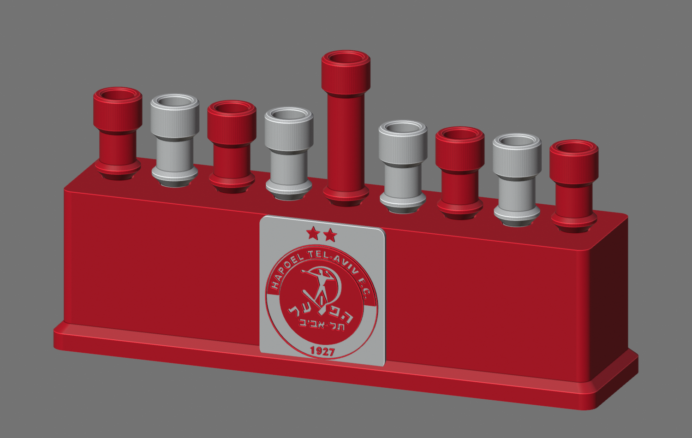

# חנוכיית הפועל תל אביב לכדורגל

מידות חיצוניות בהרכבה הן 200 × 50 × 110 מ״מ (אורך × עומק × גובה). שפת שמונת הקנים בגובה 87 מ״מ, והשמש במרכז גבוהה ב־23 מ״מ. כל השורה, כולל השמש, מתחלפת באדום ובלבן.

## הדפסה ב־Bambu Studio

1. פתחו את `Hapoel-H2D-print.3mf` ובחרו את פרופיל ה־H2D והדיזות שמותקנות אצלכם. הקובץ מכיל גאומטריה, סידור וצבעים, והגדרות המדפסת מגיעות מהפרופיל שלכם.
2. תחת Objects בדקו את השיוך לפילמנטים. במבט על, משמאל לימין בשורת הקנים, הסדר הוא אדום, לבן, אדום, לבן, שמש אדומה, לבן, אדום, לבן, אדום. הבסיס אדום. לוחית הסמל מורכבת מגב לבן ומתבליט אדום. אם הצבעים מתאפסים בייבוא, הגדירו אותם לפי המיקום וסוג החלק. בחרו שני פילמנטים מאותה משפחת חומר.
3. התחילו מגובה שכבה 0.20 מ״מ ומ־3 דפנות. הקנים עומדים על פין צר. אפשר להוסיף Brim לקנים, במיוחד לשמש. הסמל מודפס בשכיבה כשפניו כלפי מעלה. בדקו בחלון Preview ששני צבעי הסמל מופיעים ושקווי האותיות הקטנות נכנסים למסלולי ההדפסה.
4. אם הייבוא של שני חלקי הסמל אינו שומר על הצבעים, השתמשו ב־`emblem.stl` האחוד והגדירו שכבות לבנות עד 1.80 מ״מ, ואדומות החל מהשכבה הראשונה שמעל 1.80 מ״מ. אפשר לחלופין לטעון את שני קובצי הסמל המסומנים בצבע כחלקים באותו אובייקט, כאשר האדום מתחיל בגובה 1.80 מ״מ.

## הרכבה

- הדפיסו בסיס אדום אחד, ארבעה קנים אדומים רגילים, ארבעה קנים לבנים, שמש אדומה אחת וסמל אחד.
- הסירו את ה־Brim אם השתמשתם בו והכניסו את הקנים לפי הסדר שלמעלה. קוטר הפינים 9.6 מ״מ, וקוטר השקע 10.04 מ״מ. מומלץ לבדוק קנה אחד לפני הדפסת כל הקנים.
- הצמידו את לוחית הסמל למרכז החזית עם סרט דו־צדדי דק או דבק שמתאים לפילמנט. מיקום הלוחית כ־6 מ״מ מעל משטח ההנחה.
- השקעים מתוכננים לנרות לד דקים עם רגל בקוטר כ־10–11 מ״מ. קוטר השקע 11.5 מ״מ ועומקו 8 מ״מ. השתמשו בנרות לד בלבד.

`Hapoel-assembled.3mf` מציג את המודל בהרכבה, ו־`Hapoel-preview.png` מציג הדמיה. בתיקיית STL נמצאים גם חלקים נפרדים להדפסה, ובתיקיית Source נמצאים קובץ OpenSCAD וגרסת הווקטור לתבליט.

[מקור סמל המועדון — FootyLogos](https://www.footylogos.com/logos/hapoel-tel-aviv)

