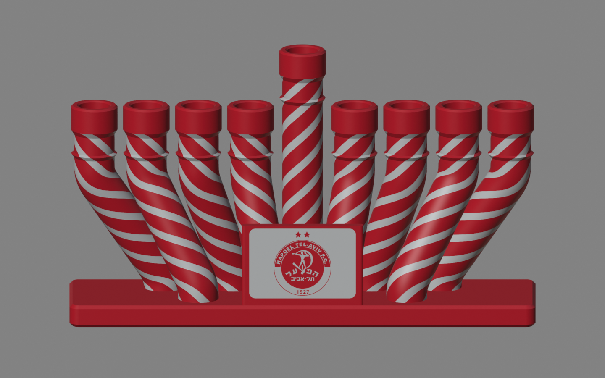

# חנוכיית הפועל תל אביב · גרסה 12 עם שקעים בקוטר 12.85 מ״מ

[תקריב של קצות הקנים](tip-detail.png)

רשת ההדפסה בקשתות נדגמת במרווח של עד **0.35 מ״מ** בגובה, ובטבעות ובצווארונים בצעדי גובה של עד **0.16 מ״מ**. גם היקף החתכים קיבל יותר נקודות. ההדמיות משתמשות בהצללה חלקה של המשטחים המעוגלים ושומרות את השפות הגאומטריות של הטבעות והפאזות. בהשוואה של אותה רשת מגרסה 10, שינוי ההצללה העלים את מרבית הפסים הדקים שנראו בהדמיה. גימור ההדפסה בפועל תלוי בגובה השכבה ובכיול המדפסת.

בכל חתך ניצב לציר המקומי של הקנה, ארבעת הפסים האדומים שווים זה לזה ורצועות הלבן מחולקות ב־90°. הסיבוב מתקדם לפי אורך המסלול לאורך הקנה. כיוון הסלסול משתקף בין ימין לשמאל, כך שזוגות הקנים זהים במבט חזיתי. קצב הסיבוב מותאם לקוטר המקומי בטבעת ובפאזה, כדי לשמור על רוחב תכנוני של כ־**5.6 מ״מ לאדום** ו־**3 מ״מ ללבן** בניצב לספירלה. בקוטר הקנה הרגיל הפסיעה כ־46.5 מ״מ לסיבוב. אלה מידות על פני גליל מקומי. זווית הצפייה והעקמומיות משפיעות על הרוחב הנראה בתמונה.

ארבעת הפסים עוברים דרך הטבעת התחתונה וממשיכים לאורך הפאזה של הצווארון עד לקצה העליון שלה. **10 המ״מ העליונים** של הקנה אדומים, כולל שפת השקע. הסמל בחזית משולב באדום ולבן.

קצות תשעת הקנים מעוצבים בסגנון גרסה 1. צווארון בקוטר 18.9 מ״מ תופס את 10 המ״מ העליונים של הקנה, כולל פאזה של 0.8 מ״מ בשפה. פאזה תחתונה בגובה 2 מ״מ מחברת אותו לקוטר הקנה המקורי, 16.4 מ״מ. שיא הטבעת התחתונה נמצא **20 מ״מ מתחת לשפה**, כ־10 מ״מ מתחת לתחילת הצווארון. קוטר הטבעת בשיאה 18.5 מ״מ. השיפוע התחתון 35° מהאנך והשיפוע העליון 55° מהאנך.

מידות החנוכייה הן **188 × 46 × 110 מ״מ**. גובה הבסיס 9 מ״מ, עם פאזות 1.25 מ״מ סביב ההיקף העליון והתחתון. הגוף, הקנים והסמל מודפסים בעמידה כיחידה אחת. אחרי ההדפסה מכניסים רק את תושבות המתכת.

## Bambu Lab H2D

1. פתח את [קובץ 3MF](print/Hapoel-H2D-menorah-v12.3mf). אם הצבעים לא נשמרים בייבוא, ייבא יחד את [STL אדום](print/Red-Right-AMS.stl) ואת [STL לבן](print/White-Left-External.stl) כחלקים באותו אובייקט ובמיקומם המקורי.
2. שייך **אדום לראש הימני דרך ה־AMS** ו**לבן לראש השמאלי מהגליל החיצוני**. בחר פרופיל H2D שמתאים לשתי הדיזות והשתמש בפילמנטים מאותה משפחת חומר.
3. נקודת התחלה לדיזות 0.4 מ״מ לגימור עדין היא שכבה של 0.12–0.16 מ״מ, עם הבסיס שטוח ותמיכות כבויות. אחרי Slice Plate בדוק את החלק התחתון של הטבעות והצווארונים, את רציפות ארבעת הפסים לאורך הפאזה, את קצות הקנים האדומים ואת הסמל. הוסף תמיכות מקומיות אם הסלייסר מצביע על צורך. הגאומטריה נבדקה ממוחשבת. הגרסה טרם נבדקה ב־Bambu Studio או בהדפסה פיזית.

## תושבות מתכת

בכל תשעת השקעים הקוטר הפנימי **12.85 מ״מ**, העומק **15.5 מ״מ**, ופאזת הכניסה **0.6 מ״מ ב־45°**. הקוטר בשפה הוא **14.05 מ״מ**. הדופן הפנימית מתחת לפאזה גלילית. מרווח מרכזי השקעים 21 מ״מ.

דוגמת ההתאמה משחזרת את העומק והפאזה החדשים. הקטרים שלה **12.45, 12.65, 12.85 ו־13.05 מ״מ**, החל מהקצה המחורץ. מוצר AliExpress שמסומן 11.8 מ״מ נשאר מועמד. מידת הגוף שמתחת לשפה והתאמתו הפיזית טרם אומתו. [דוגמת ההתאמה](print/Metal-cup-fit-test.stl) · [דף המוצר](https://www.aliexpress.com/item/1005006310134287.html)

**לנרות לד בלבד.** תושבת מתכת עלולה להוליך חום מלהבה אל הפלסטיק.

[קובצי המקור](Source) · [מקור סמל המועדון](https://www.footylogos.com/logos/hapoel-tel-aviv)
