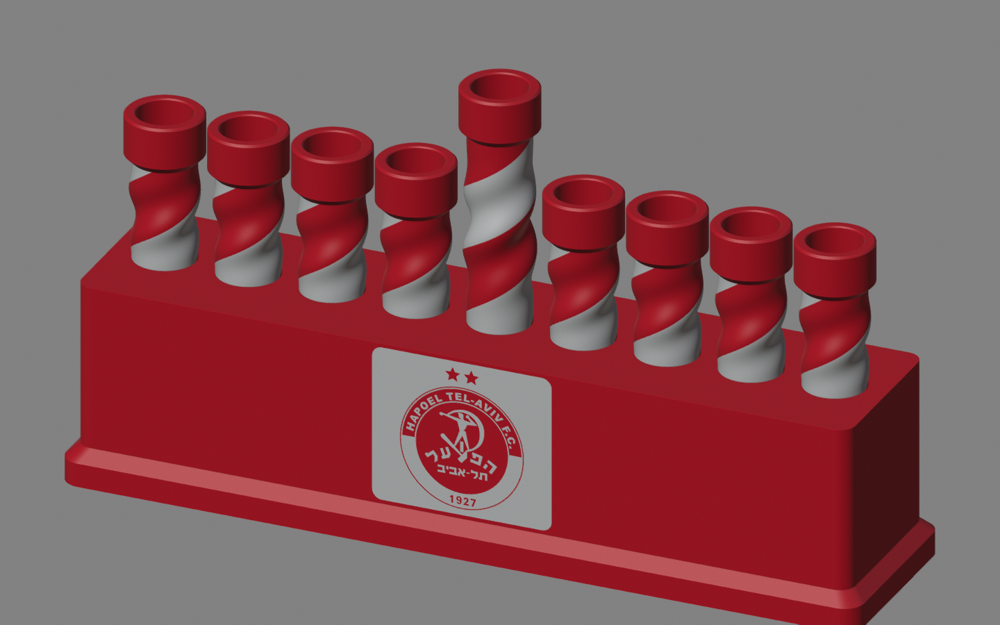

# חנוכיית הפועל תל אביב · גרסה 2

הבסיס, תשעת הקנים והסמל מודפסים בעמידה כיחידה אחת בשני צבעים. לאחר ההדפסה מכניסים תשע תושבות מתכת קנויות לשקעים.

מידות הגוף הן **200 מ״מ אורך × 50 מ״מ עומק × 110 מ״מ גובה**. שפת שמונת הקנים הרגילים בגובה 87 מ״מ והשמש בגובה 110 מ״מ. המרחק בין מרכזי השקעים 21 מ״מ. האדום והלבן מסתלסלים לאורך כל קנה. הסמל האדום משולב בשדה לבן בקו אחד עם החזית.

## Bambu Lab H2D עם שני ראשים

| צבע | ראש | הזנה |
| --- | --- | --- |
| אדום | ימין | התא שבו טעון האדום ב־AMS |
| לבן | שמאל | גליל חיצוני יחיד |

1. פתח את [קובץ 3MF](print/Hapoel-H2D-spiral-v2.3mf) ב־Bambu Studio ובחר את פרופיל ה־H2D המתאים לקוטר הדיזות שלך. הקובץ מכיל אובייקט אחד ושני חלקי צבע. שיוך הפילמנטים לראשים ולתאים נעשה ב־Bambu Studio.
2. אם הייבוא מאבד את הצבעים, בחר יחד את [האדום](print/Red-Right-AMS.stl) ואת [הלבן](print/White-Left-External.stl) ובחר לטעון אותם כחלקים באותו אובייקט. לשניהם אותה מערכת קואורדינטות. השאר את מיקומם היחסי כפי שיובא.
3. סנכרן את הפילמנטים מהמדפסת. ב־Objects שייך את הפילמנט האדום לגאומטריה האדומה ואת הלבן ללבנה. בשיוך הראשים בחר AMS ימין לאדום ו־External שמאל ללבן. השתמש בפילמנטים מאותה משפחת חומר ובדיזות באותו קוטר.
4. נקודת פתיחה לדיזות 0.4 מ״מ היא שכבה של 0.20 מ״מ, שלוש דפנות ו־15% מילוי. המודל עומד על הבסיס ומיועד להדפסה ללא תמיכות. השאר את מגדל הייצוב אם הפרופיל מוסיף אותו.
5. אחרי **Slice Plate**, בדוק ב־Preview שהסלילים מופיעים בשני צבעים, שתשעת השקעים פתוחים ושהאותיות הקטנות בסמל מקבלות מסלולי הדפסה. בחלון השליחה ודא שכל צבע משויך לראש הנכון. הגאומטריה נבדקה ממוחשבת. גרסה זו טרם נבדקה בהדפסה פיזית או ב־Bambu Studio.

[מדריך H2D של Bambu Lab](https://csm.bblcdn.com/hub/4668d0ca43994ff3bff4b37f1a65c2e7.pdf)

## תושבות המתכת והנרות

- השקע במודל הוא **Ø13.6 מ״מ בעומק 10.4 מ״מ**, עם פאזה בכניסה. התושבת צריכה להיכנס בלי לחץ ולהיתמך על השפה. חפש גוף חיצוני ברוחב עד כ־13.2 מ״מ מתחת לשפה, אורך שקוע עד כ־10 מ״מ ושפה בקוטר כ־17–19 מ״מ.
- דוגמה לקנייה היא תושבת JewFadz, מק״ט CHA-18METALHOLDERS-03. המוכר מציין שפה כ־19.05 מ״מ, תחתית חיצונית כ־11.11 מ״מ וגובה כ־9.53 מ״מ. הקוטר המרבי מתחת לשפה אינו מפורסם, ולכן ההתאמה הפיזית טרם אומתה. [דף התושבות](https://www.jewfadz.com/metal-menorah-bases-inserts-18-pieces.html)
- הדפס קודם את [דוגמת ההתאמה](print/Metal-cup-fit-test.stl). ארבעת השקעים מסודרים בכיוון X החיובי לפי הקטרים **12.4, 13.0, 13.6, 14.2 מ״מ**. בחר את הקוטר שבו התושבת נכנסת בקלות ונשענת על השפה בלי להתנדנד.
- בחר נרות לד לפי הקוטר הפנימי של התושבת. בדוגמה המסחרית הפתח כ־9.53 מ״מ, וקוטר בסיס הלד צריך להיות מעט קטן יותר.
- **לד בלבד.** תושבת המתכת יכולה להוליך חום אל הקן המודפס, והדגם לא עבר בדיקת עמידות באש. אין להשתמש בו בנרות עם להבה או בשמן בוער.

## התאמת קוטר השקע

קובצי המקור נמצאים בתיקיית [Source](Source). להתאמה דרושים OpenSCAD ופייתון עם החבילות numpy, trimesh ו־manifold3d.

    python Source/build.py print-custom --diameter 14.2 --depth 10.4

הפקודה מפיקה את שני גופי הצבע, את קובץ ה־3MF ואת דוגמת ההתאמה בקוטר המעודכן.

[מקור סמל המועדון](https://www.footylogos.com/logos/hapoel-tel-aviv)
