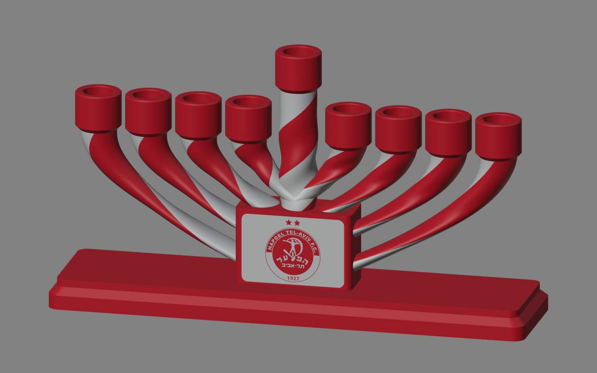

# חנוכיית הפועל תל אביב · גרסה 3 בצורת מנורה

ארבע זרועות קמורות בכל צד עולות לגובה אחיד. השמש במרכז גבוהה ב־23 מ״מ. האדום והלבן מסתלסלים בזרועות ובשמש, וסמל הפועל תל אביב בכדורגל משולב בחזית בגובה פני השטח. מידות הגוף **200 × 50 × 110 מ״מ**. הגוף כולו מודפס בעמידה בפעולה אחת, ללא הדבקה או הרכבה של חלקי פלסטיק. אחרי ההדפסה מסירים את התמיכות ומכניסים את תשע תושבות המתכת.

## קובצי הדפסה והגדרות H2D

- [3MF דו־צבעי](print/Hapoel-H2D-menorah-v3.3mf) עם אובייקט אחד ושני חלקי צבע.
- אם הצבעים אינם נשמרים בייבוא, ייבא יחד את [STL אדום](print/Red-Right-AMS.stl) ואת [STL לבן](print/White-Left-External.stl) כחלקים באותו אובייקט. שמור על המיקום היחסי שלהם.
- ב־Bambu Studio בחר את פרופיל ה־H2D שמתאים לדיזות שלך וסנכרן פילמנטים. שייך **אדום לראש הימני דרך AMS** ו־**לבן לראש השמאלי דרך External spool**. השיוך הפיזי נעשה בסלייסר. השתמש בפילמנטים מאותה משפחת חומר ובדיזות בקוטר זהה.
- לדיזות 0.4 מ״מ, התחל משכבה של 0.20 מ״מ, שלוש דפנות ו־15% מילוי. הפעל תמיכות מתחת לקשתות. אפשר להתחיל ב־Tree עם Build plate only ולבדוק בתצוגה המקדימה שכל אזור תלול מקבל תמיכה ושיש גישה להסרתה. הימנע מתמיכות בתוך תשעת השקעים. בדוק את שני הצבעים ואת האותיות הקטנות בסמל אחרי Slice Plate.
- המידות, סגירות הרשת וחיבור הגוף נבדקו ממוחשבת. הדגם טרם נבדק ב־Bambu Studio או בהדפסה פיזית.

[מדריך Bambu Lab H2D](https://csm.bblcdn.com/hub/4668d0ca43994ff3bff4b37f1a65c2e7.pdf)

## תושבות מתכת מ־AliExpress

מועמד לקנייה הוא מוצר **1005006310134287**, סט של 10 כוסיות עם שפה שמסומן **11.8 מ״מ**. תמונת המוצר מציגה כוסיות עם שפה. עמוד AliExpress הישיר לא היה נגיש בבדיקה, והקטלוג המקושר לא מבהיר אם 11.8 מ״מ הוא הקוטר הפנימי או החיצוני. הזמינות, אפשרויות המשלוח וההתאמה הפיזית טרם אומתו. [AliExpress](https://www.aliexpress.com/item/1005006310134287.html) · [הקטלוג המציג את המוצר ותמונתו](https://boxtoroom.com/de/item/1005006310134287/10pcs-11-8mm-candle-holder-home-decor-wax-candles-cups-jars-candlestic/)

השקעים במודל הם בקוטר **12.6 מ״מ** ובעומק **14 מ״מ** עם פאזה בכניסה. לפני שמזמינים, כדאי לבקש מהמוכר שלוש מידות: קוטר חיצוני מרבי של הגוף מתחת לשפה, גובה הגוף מתחת לשפה וקוטר השפה. לדגם ברירת המחדל חפש גוף חיצוני בקוטר כ־12.1–12.3 מ״מ, גובה עד כ־13.7 מ״מ ושפה בקוטר כ־13.5–19 מ״מ. מרחק המרכזים הוא 21 מ״מ. בחר נרות לד לפי הקוטר הפנימי בפועל.

[דוגמת התאמה להדפסה](print/Metal-cup-fit-test.stl) כוללת קטרים **11.4, 12.0, 12.6, 13.2 מ״מ**, מהקצה עם המגרעת לקצה השני. בחר את השקע שבו הכוסית נכנסת בלי לחץ והשפה יושבת שטוח. אם קוטר אחר מתאים יותר, אפשר לבנות את קובץ ההדפסה מחדש מ־[Source](Source), עם OpenSCAD ופייתון עם numpy, trimesh ו־manifold3d:

    python Source/build.py print-custom --diameter 13.2 --depth 14

**נרות לד בלבד.** כוסית מתכת מוליכה חום אל הפלסטיק. גוף זה לא עבר בדיקות חום או אש.

[מקור סמל המועדון](https://www.footylogos.com/logos/hapoel-tel-aviv)
