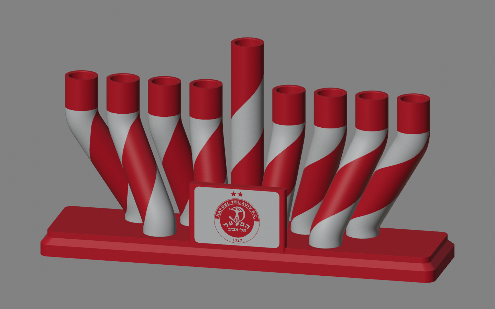

# חנוכיית הפועל תל אביב · גרסה 4 עם קנים בקוטר אחיד

מידות הגוף הן **200 × 50 × 110 מ״מ**. גוף החנוכייה מודפס בעמידה כיחידה אחת. תשעת הקנים עגולים בקוטר חיצוני **16.4 מ״מ**, לרבות הדופן החיצונית סביב שקע המתכת. החתך העגול נמדד בניצב לכל קנה. הקנים מתחילים בנפרד בבסיס ומתכנסים לשורה ישרה בחלק העליון. כך הם שומרים על הרוחב שלהם בכל האורך, כולל מקום המעבר לשקע. שמונת הקנים בגובה 87 מ״מ, והשמש במרכז בגובה 110 מ״מ.

הסליל האדום־לבן נוצר מהחלפת צבעים בתוך הקוטר הקבוע. סמל הפועל תל אביב בכדורגל מודפס במישור הלוח הלבן שבחזית כחלק מהגוף. לאחר ההדפסה מכניסים רק את תשע תושבות המתכת.

## הדפסה עם מעט תמיכות

- פתח את [קובץ 3MF](print/Hapoel-H2D-menorah-v4.3mf) ב־Bambu Studio. זהו אובייקט אחד עם שני חלקי צבע. אם הייבוא מאבד את הצבעים, ייבא יחד את [STL אדום](print/Red-Right-AMS.stl) ואת [STL לבן](print/White-Left-External.stl) כחלקים באותו אובייקט ובמיקום המקורי שלהם.
- שייך **אדום לראש הימני דרך ה־AMS** ו**לבן לראש השמאלי מהגליל החיצוני**. השתמש בפילמנטים מאותה משפחת חומר ודיזות בקוטר זהה.
- התחל במנח המקורי על הבסיס, שכבה 0.20 מ״מ עם דיזות 0.4 מ״מ, ועם תמיכות כבויות. אחרי Slice Plate בדוק שאין אזהרות על אזורים תלויים, שהשקעים פתוחים ושאותיות הסמל מופיעות. אם הפרופיל מזהה צורך בתמיכה, הוסף תמיכה מקומית בלבד במקום המסומן ובדוק שוב.
- בדיקת הגאומטריה כללה חתכים עגולים, העדר חפיפות בין הקנים, סגירות הרשת וזווית הקירות החיצוניים של הקנים. הגרסה טרם נבדקה פיזית או ב־Bambu Studio.

## תושבות מתכת

השקעים נשארו במידות **12.6 מ״מ בקוטר ובעומק 14 מ״מ**. דגם 10 הכוסיות מ־AliExpress המסומן 11.8 מ״מ הוא מועמד לבדיקה. לא אומת אם זה קוטר פנימי או חיצוני או אם המוצר זמין למשלוח. דופן הקן החיצונית צרה יותר בגרסה זו. כוסית עם שפה רחבה יכולה לבלוט מעט מעבר לקן. מרווח המרכזים בין הקנים 21 מ״מ, ולכן רצוי שקוטר השפה יהיה עד 19 מ״מ. מומלץ לבדוק קודם את [דוגמת ההתאמה](print/Metal-cup-fit-test.stl), עם שקעים 11.4, 12.0, 12.6 ו־13.2 מ״מ מהקצה עם המגרעת. [המוצר ב־AliExpress](https://www.aliexpress.com/item/1005006310134287.html) · [קטלוג עם תמונת המוצר](https://boxtoroom.com/de/item/1005006310134287/10pcs-11-8mm-candle-holder-home-decor-wax-candles-cups-jars-candlestic/)

**לנרות לד בלבד.** תושבת מתכת יכולה להוליך חום מלהבה לגוף הפלסטיק.

[קובצי המקור](Source) · [מקור סמל המועדון](https://www.footylogos.com/logos/hapoel-tel-aviv)
