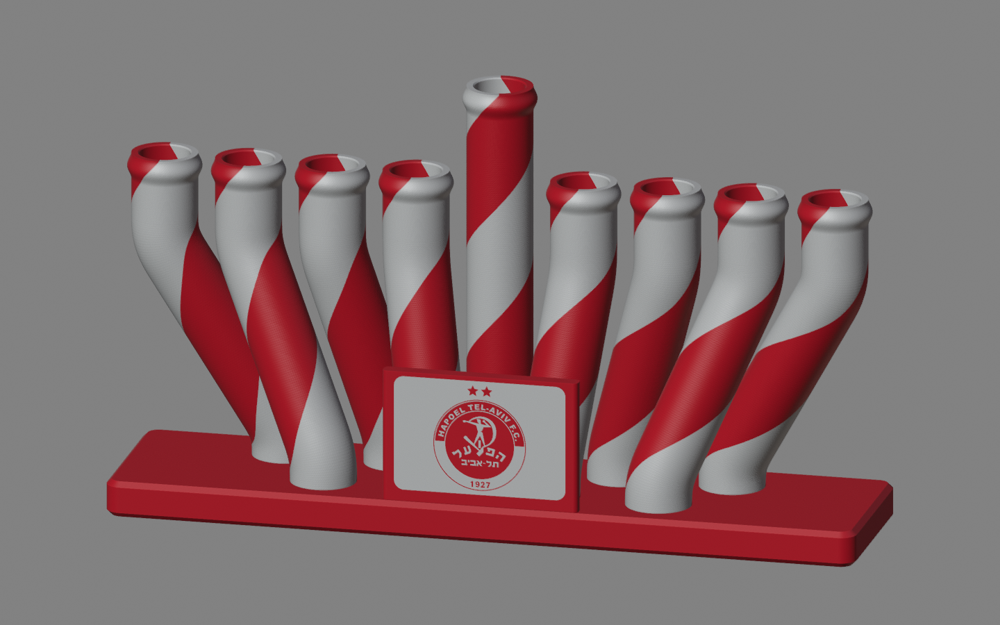

# חנוכיית הפועל תל אביב · גרסה 5

הסליל האדום־לבן ממשיך מהבסיס דרך הקן ועד לשפת השקע, כולל הטבעת הבולטת ליד כל פתח. גוף הקן נשאר בקוטר 16.4 מ״מ והטבעת מתרחבת בהדרגה עד 18.4 מ״מ. שמונת הקנים בגובה 87 מ״מ והשמש בגובה 110 מ״מ.

מידות הגוף הן **188 × 46 × 110 מ״מ**. הבסיס בגובה **9 מ״מ** וכולל פאזות **1.25 מ״מ ב־45°** סביב ההיקף העליון והתחתון ופינות מעוגלות במבט מלמעלה. הסמל משולב בלוח שבחזית. החנוכייה מודפסת בעמידה כיחידה אחת. אחרי ההדפסה מכניסים רק את תושבות המתכת.

## Bambu Lab H2D

1. פתח את [קובץ 3MF](print/Hapoel-H2D-menorah-v5.3mf) ב־Bambu Studio. אם הצבעים לא מופיעים בייבוא, ייבא יחד את [STL אדום](print/Red-Right-AMS.stl) ואת [STL לבן](print/White-Left-External.stl) כחלקים של אובייקט אחד ובמיקום המקורי.
2. שייך **אדום לראש הימני דרך ה־AMS** ו**לבן לראש השמאלי מהגליל החיצוני**. בחר בפרופיל ה־H2D שתואם לקוטר הדיזות. השתמש בפילמנטים מאותה משפחת חומר ובשתי דיזות בקוטר זהה.
3. התחל כשהבסיס שטוח על המשטח, עם תמיכות כבויות. נקודת פתיחה לדיזות 0.4 מ״מ היא שכבה של 0.20 מ״מ. אחרי Slice Plate בדוק את תחתית הטבעות, הפאזות, מסלולי האותיות בסמל ופתיחות השקעים. הוסף תמיכה מקומית אם התצוגה מצביעה על צורך. הגאומטריה נבדקה ממוחשבת. הגרסה טרם נבדקה ב־Bambu Studio או בהדפסה פיזית.

## תושבות מתכת

קוטר השקעים **12.6 מ״מ** ועומקם **14 מ״מ**. קוטר השפה הרצוי של תושבת המתכת הוא עד 19 מ״מ ומרווח המרכזים הוא 21 מ״מ. הכוסית מ־AliExpress שמסומנת 11.8 מ״מ עדיין מועמדת להתאמה. לא אומת אם זה קוטר פנימי או חיצוני. מדוד את הגוף מתחת לשפה ובדוק אותו תחילה ב[דוגמת ההתאמה](print/Metal-cup-fit-test.stl), עם שקעים בקטרים 11.4, 12.0, 12.6 ו־13.2 מ״מ מהקצה המחורץ. [דף המוצר ב־AliExpress](https://www.aliexpress.com/item/1005006310134287.html)

**לנרות לד בלבד.** תושבת המתכת עלולה להוליך חום מלהבה אל גוף הפלסטיק.

[קובצי המקור](Source) · [מקור סמל המועדון](https://www.footylogos.com/logos/hapoel-tel-aviv)
