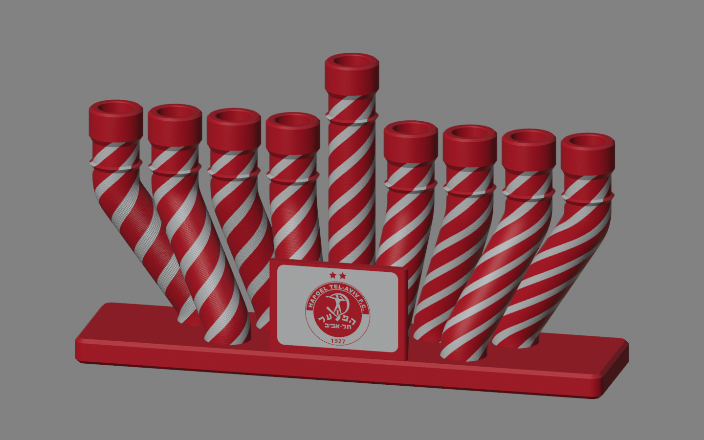

# חנוכיית הפועל תל אביב · גרסה 9 עם ארבעה פסים ספירליים

[תקריב של קצות הקנים](tip-detail.png)

בכל אחד מתשעת הקנים יש ארבעה פסים לבנים, המחולקים במרווח זוויתי של 90° בגובה נתון. רוחב הפס המתוכנן הוא **3 מ״מ** בניצב לספירלה על הקנה הישר. הפסיעה היא **46.5 מ״מ לסיבוב**, כך שהמרווח האנכי בין שולי הפסים באותו כיוון סביב הקנה הוא כ־**7.6 מ״מ** באזור בקוטר 16.4 מ״מ. המרווח הנמדד בניצב לפסים על הקטע הישר הוא כ־**5.6 מ״מ**. לאורך הקשתות המרחק הקצר ביותר על פני המודל עשוי להשתנות עם העקמומיות.

ארבעת הפסים עוברים דרך הטבעת התחתונה וממשיכים לאורך הפאזה של הצווארון עד לקצה העליון שלה. **10 המ״מ העליונים** של הקנה אדומים, כולל שפת השקע. הסמל בחזית משולב באדום ולבן.

קצות תשעת הקנים מעוצבים בסגנון גרסה 1. צווארון בקוטר 18.9 מ״מ תופס את 10 המ״מ העליונים של הקנה, כולל פאזה של 0.8 מ״מ בשפה. פאזה תחתונה בגובה 2 מ״מ מחברת אותו לקוטר הקנה המקורי, 16.4 מ״מ. שיא הטבעת התחתונה נמצא **20 מ״מ מתחת לשפה**, כ־10 מ״מ מתחת לתחילת הצווארון. קוטר הטבעת בשיאה 18.5 מ״מ. השיפוע התחתון 35° מהאנך והשיפוע העליון 55° מהאנך.

מידות החנוכייה הן **188 × 46 × 110 מ״מ**. גובה הבסיס 9 מ״מ, עם פאזות 1.25 מ״מ סביב ההיקף העליון והתחתון. הגוף, הקנים והסמל מודפסים בעמידה כיחידה אחת. אחרי ההדפסה מכניסים רק את תושבות המתכת.

## Bambu Lab H2D

1. פתח את [קובץ 3MF](print/Hapoel-H2D-menorah-v9.3mf). אם הצבעים לא נשמרים בייבוא, ייבא יחד את [STL אדום](print/Red-Right-AMS.stl) ואת [STL לבן](print/White-Left-External.stl) כחלקים באותו אובייקט ובמיקומם המקורי.
2. שייך **אדום לראש הימני דרך ה־AMS** ו**לבן לראש השמאלי מהגליל החיצוני**. בחר פרופיל H2D שמתאים לשתי הדיזות והשתמש בפילמנטים מאותה משפחת חומר.
3. נקודת התחלה לדיזות 0.4 מ״מ היא שכבה של 0.20 מ״מ, עם הבסיס שטוח ותמיכות כבויות. אחרי Slice Plate בדוק את החלק התחתון של הטבעות והצווארונים, את רציפות ארבעת הפסים לאורך הפאזה, את קצות הקנים האדומים ואת הסמל. הוסף תמיכות מקומיות אם הסלייסר מצביע על צורך. הגאומטריה נבדקה ממוחשבת. הגרסה טרם נבדקה ב־Bambu Studio או בהדפסה פיזית.

## תושבות מתכת

השקעים בקוטר **12.6 מ״מ** ובעומק **14 מ״מ**, במרווח מרכזים של 21 מ״מ. דוגמת ההתאמה כוללת קטרים 11.4, 12.0, 12.6 ו־13.2 מ״מ, החל מהקצה המחורץ. מוצר AliExpress שמסומן 11.8 מ״מ נשאר מועמד. מידת הגוף שמתחת לשפה והתאמתו הפיזית טרם אומתו. [דוגמת ההתאמה](print/Metal-cup-fit-test.stl) · [דף המוצר](https://www.aliexpress.com/item/1005006310134287.html)

**לנרות לד בלבד.** תושבת מתכת עלולה להוליך חום מלהבה אל הפלסטיק.

[קובצי המקור](Source) · [מקור סמל המועדון](https://www.footylogos.com/logos/hapoel-tel-aviv)
